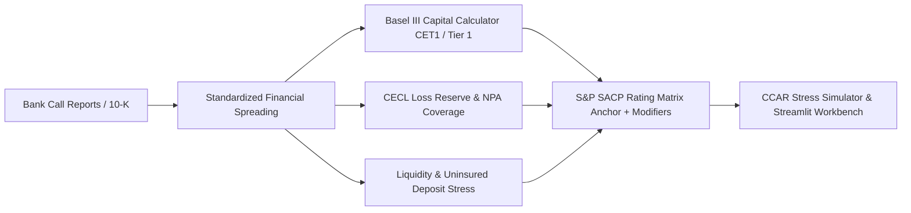

# S&P Global Bank Credit Rating & Basel III Capital Intelligence Engine

An institutional-grade bank financial statement spreading, Basel III regulatory capital stress-testing, and S&P Stand-Alone Credit Profile (SACP) evaluation engine designed for S&P Global Ratings Financial Institutions Group (FIG).

## System Architecture



## Key Capabilities
- **Basel III Regulatory Capital Modeling:** Calculates Common Equity Tier 1 (CET1), Tier 1 Leverage, and Total Capital ratios against regulatory thresholds.
- **S&P Stand-Alone Credit Profile (SACP):** Applies S&P Bank Rating Methodology starting from the BICRA anchor ('BBB+') with analytical modifiers across Capital & Earnings, Risk Position (NPA & CECL), and Funding & Liquidity.
- **Dodd-Frank / CCAR Macroeconomic Stress Simulation:** Stress-tests bank capital under severe loan loss rates and RWA expansion scenarios.
- **Interactive Credit Surveillance Portal:** Streamlit dashboard providing peer group benchmarking and credit committee presentation cards.

## Core Modules
- `src/core_engine.py`: Bank financials structures, regulatory capital metrics, SACP rating notching, and CCAR stress modeling.
- `app/streamlit_app.py`: Streamlit bank surveillance and rating committee workbench.
- `tests/test_core.py`: Comprehensive test suite verifying capital ratios, SACP notching logic, and stress tests.

## Quickstart
```bash
pip install -r requirements.txt
python -m pytest tests/ -v
streamlit run app/streamlit_app.py
```

## Author
Bhupesh Chandra Dimri (bhupeshcdimri21@gmail.com)  
M.S. in Accounting Analytics & Data Technology, Pace University  
Bloomberg BMC & BFF Certified • CPA Candidate
